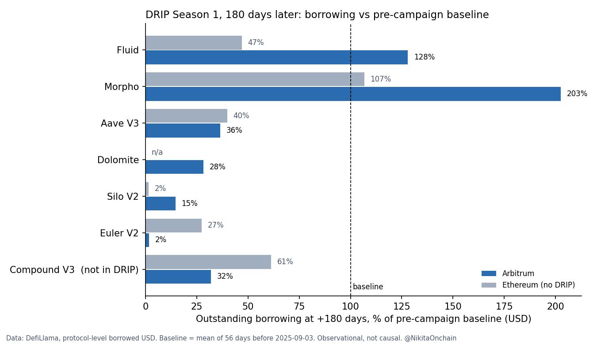

# DRIP Season 1, 180 days later: a protocol-level check

A quick, reproducible check of what happened to borrowing in the six lending protocols of Arbitrum DRIP Season 1, 180 days after the season ended. It uses public DefiLlama data.

It is a companion to the detailed Morpho study: [morpho-drip-retention](https://github.com/NikitaOnchain/morpho-drip-retention).



## Key results

Outstanding borrowing at +180 days (2026-08-17), as % of the pre-campaign baseline:

| Protocol | Arbitrum (DRIP) | Ethereum (no DRIP) | Base (no DRIP) |
|---|---:|---:|---:|
| Fluid | **128%** | 47% | 49% |
| Morpho | **203%** (peak at campaign end: 2,055%) | 107% | 228% |
| Aave V3 | 36% | 40% | 51% |
| Dolomite | 28% | n/a | n/a |
| Silo V2 | 15% | 2% | n/a |
| Euler V2 | **2%** | 27% | 62% |
| Compound V3 (not in DRIP) | 32% | 61% | 33% |

1. **Fluid is the only DRIP protocol whose Arbitrum borrowing stayed above its pre-campaign level.** On Ethereum and Base, Fluid fell to about half of baseline over the same period.
2. **Morpho's 20× lift mostly unwound.** It retained about 5% of its campaign-end uplift. Arbitrum borrowing ended at 2× baseline, but Morpho on Base grew 2.3× without DRIP over the same period.
3. **Aave and Dolomite moved with the market.** Compound V3 on Arbitrum, which was not in DRIP, fell to 32% of baseline. Aave on Arbitrum (36%) is close to Aave on Ethereum (40%).
4. **Euler on Arbitrum fell much faster than Euler elsewhere** (2% vs 27% on Ethereum).
5. **Silo V2 fell on both chains.** Silo v3 launched in March 2026, so this is likely a version migration, not a DRIP effect.

## Method

- **Source:** DefiLlama protocol API (`https://api.llama.fi/protocol/<slug>`), daily `<Chain>-borrowed` series in USD.
- **Baseline:** mean of the 56 daily values from 2025-07-09 to 2025-09-02. This is the same window as the Morpho study.
- **Checkpoints:** campaign end 2026-02-18, then +30, +90 and +180 days.
- **Comparison:** the same protocol on Ethereum and Base (no DRIP), plus Compound V3 on Arbitrum (not in DRIP). Deployments with a baseline below $5M are skipped.

Run it yourself (Python 3.10+):

```
python -m venv .venv
.venv/Scripts/python -m pip install -r requirements.txt
.venv/Scripts/python drip_s1_180d.py
```

On macOS or Linux, use `.venv/bin/python`. The script downloads fresh data, so numbers can differ slightly if DefiLlama revises its history.

## Files

| File | What it is |
|---|---|
| `drip_s1_180d.py` | The whole analysis: download, checkpoints, CSV, charts |
| `data/drip_s1_borrowed_index.csv` | Checkpoint values in USD and as % of baseline, per protocol and chain |
| `data/defillama_borrowed_daily.csv` | Daily borrowed USD series used here, from 2025-07-09 (snapshot of 2026-10-09) |
| `figures/drip_s1_180d_bars.png` | Borrowing at +180 days: Arbitrum vs Ethereum |
| `figures/drip_s1_180d_lines.png` | Trajectory on Arbitrum, log scale |

## Limitations

- **Protocol-level, not market-level.** The numbers cover all markets of a protocol on a chain, not only DRIP-eligible markets. As a check, the Morpho figure here (about 5% of uplift retained) is close to the market-level study (7.7% USDC, 11.3% USD₮0).
- **USD terms.** ETH fell by more than 50% during the season. Most borrowing is in stablecoins, but lower collateral prices also reduce how much people can borrow.
- **Observational, not causal.** Other events affected these protocols. These include the Stream Finance collapse in November 2025, Silo v3 (March 2026), Dolomite's WLFI/USD1 market on Ethereum (January 2026) and Fluid DEX on Arbitrum (from May 2026).
- **No wallet cohorts.** This check does not show whether the same users stayed.
- DefiLlama data can be revised. Raw files are cached in `data/raw/` on the run date.

_Data downloaded 2026-10-09. Independent pseudonymous analysis, not affiliated with Arbitrum, DRIP or any protocol named here._
